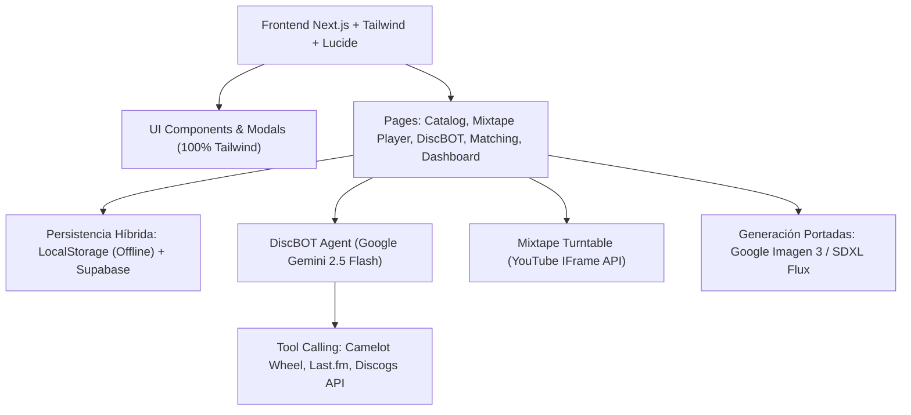

# Índice de Documentación: Diskogs Plus (v2.0)

Bienvenido a la carpeta de documentación técnica y de evolución de **Diskogs Plus**. Aquí se agrupan los informes de auditoría, las decisiones de arquitectura, el balance de mejoras implementadas y la hoja de ruta de tareas pendientes.

---

## 📚 Documentos Disponibles

| Documento | Descripción | Estado |
| :--- | :--- | :---: |
| [**`docs/balance_v2_y_roadmap.md`**](./balance_v2_y_roadmap.md) | **Balance consolidado de la v2.0**: Resumen de todas las mejoras aplicadas (Google Gemini 2.5 Flash, YouTube Player, migración total de Material-UI a Tailwind, persistencia híbrida, seguridad) y listado de tareas pendientes priorizadas. | 🟢 Actualizado |
| [**`docs/auditoria_tecnica_inicial.md`**](./auditoria_tecnica_inicial.md) | **Auditoría Técnica de partida**: Diagnóstico exhaustivo del estado del proyecto tras 3 años de inactividad, análisis de deuda técnica, vulnerabilidades de seguridad encontradas y propuesta original de arquitectura. | 📄 Histórico |

---

## 🛠️ Resumen de la Arquitectura v2.0



---

## 🚀 Guía Rápida para Desarrolladores

### 1. Variables de Entorno (`.env.local`)
Asegúrate de tener configurado tu archivo `.env.local` con las siguientes claves esenciales:
```env
# Google AI Studio (DiscBOT Agent y Enriquecimiento)
GEMINI_API_KEY=tu_clave_de_gemini
GEMINI_MODEL=gemini-2.5-flash

# Last.fm (Biografías y Metadatos Contextuales)
LASTFM_API_KEY=tu_clave_lastfm

# Discogs API
CONSUMER_KEY=tu_consumer_key
CONSUMER_SECRET=tu_consumer_secret
```

### 2. Comandos Clave
* **Ejecutar en desarrollo:** `npm run dev`
* **Verificar TypeScript:** `npx tsc --noEmit`
* **Ejecutar linter:** `npm run lint`
* **Compilación de producción:** `npm run build`
