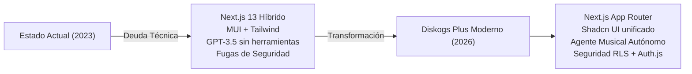
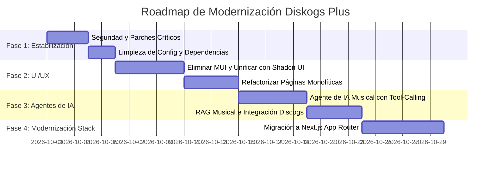
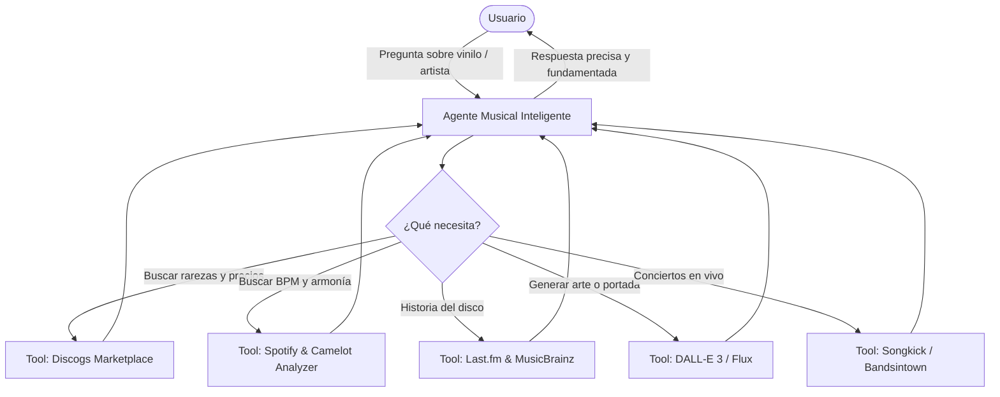

# Auditoría Técnica y Propuesta de Evolución: Diskogs Plus

> **Fecha:** Octubre 2026 (o 3 años tras desarrollo inicial ~2023)  
> **Proyecto:** [Diskogs Plus](../README.md)  
> **Objetivo:** Diagnóstico del estado actual de partida, identificación de deuda técnica y brechas de seguridad, y definición de una hoja de ruta para modernizar la aplicación y transformarla en una plataforma musical impulsada por **Agentes de IA**.

---

## 1. Resumen Ejecutivo

**Diskogs Plus** es un proyecto con un concepto central sumamente valioso y original: fusionar la gestión de colecciones de vinilos de **Discogs** con metadatos de audio de **Spotify** (tempo BPM, clave musical y notación armónica Camelot para DJs), enriquecimiento contextual con **Last.fm**, generación de portadas y un asistente musical con IA (**DiscBOT**).

Sin embargo, dado que fue desarrollado hace ~3 años:
1. **El ecosistema de IA ha cambiado radicalmente**: El proyecto usa la API básica de Chat Completions con `gpt-3.5-turbo` y `ai` v2.2. No existía soporte nativo para *Tool Calling*, memoria conversacional estructurada, agentes autónomos ni RAG (*Retrieval-Augmented Generation*).
2. **Existen vulnerabilidades críticas de seguridad**: El endpoint `/api/getApiKey` expone claves privadas de OpenAI sin autenticación, y la autorización en frontend se basa en cookies no firmadas manipulables por el cliente.
3. **Deuda técnica en Frontend y Next.js**: Conviven dos bibliotecas UI incompatibles (`@mui/material` y `Tailwind CSS`), configuraciones duplicadas, discrepancias en prefijos (`tw-`), y páginas monolíticas de más de 1.100 líneas.
4. **Riesgos en APIs de terceros**: Cambios recientes en la política de Spotify (como la restricción o deprecación del endpoint `/audio-features` para apps no verificadas) y librerías sin mantenimiento (`disconnect`).



---

## 2. Diagnóstico Técnico del Estado de Partida (Auditoría)

### 2.1. Seguridad y Autenticación (Prioridad Crítica)

> [!CAUTION]
> **Vulnerabilidad Crítica detectada en [`pages/api/getApiKey.ts`](../pages/api/getApiKey.ts)**  
> Cualquier usuario o atacante puede enviar una petición `POST /api/getApiKey` con el cuerpo `{"username": "victima"}` y el servidor retornará la clave de OpenAI descifrada en texto plano sin comprobar sesión, cookie de autenticación ni tokens.

1. **Exposición de claves**: Las claves API de OpenAI ingresadas por los usuarios se almacenan en Supabase cifradas con AES mediante `crypto-js`, pero el endpoint de lectura no tiene middleware ni comprobación de identidad.
2. **Protección de rutas débil**:
   * En [`components/Layout.tsx`](../components/Layout.tsx#L41), la verificación de sesión se realiza en el cliente:
     ```typescript
     const isUserLoggedIn = !!getCookie("username");
     if (!isUserLoggedIn && !allowPublicAccess) {
       router.replace("/");
     }
     ```
     Cualquier usuario puede abrir la consola del navegador y ejecutar `document.cookie = "username=admin"` para saltarse el redireccionamiento.
   * No existe un `middleware.ts` en la raíz de Next.js para proteger las rutas en el Edge/Servidor antes de renderizar la página.
3. **Cifrado de OAuth 1.0a en Cookies**:
   * En [`pages/api/auth/authorize.ts`](../pages/api/auth/authorize.ts#L34), el token de solicitud de Discogs se cifra con `CryptoJS.AES` y se guarda en cookies del navegador usando `CRYPT_KEY`. Es vulnerable si la clave se ve comprometida o no se rota.
4. **Supabase sin RLS vinculado a Discogs**:
   * [`lib/supabase.ts`](../lib/supabase.ts) inicializa el cliente con `auth.persistSession: false`. Todas las consultas desde el frontend corren bajo el rol `anon`, lo que significa que o bien las tablas tienen RLS deshabilitado (inseguro) o políticas permisivas que aceptan cualquier `username` enviado por parámetro.
5. **Inconsistencia en Variables de Entorno**:
   * [`.env.local.sample`](../.env.local.sample) define `SUPABASE_URL` y `SUPABASE_ANON_KEY`, mientras que [`lib/supabase.ts`](../lib/supabase.ts) busca `NEXT_PUBLIC_SUPABASE_URL` y `NEXT_PUBLIC_SUPABASE_ANON_KEY`.

---

### 2.2. Arquitectura de IA y LLMs

> [!WARNING]
> La implementación actual utiliza patrones de principios de 2023 (`gpt-3.5-turbo` simple, sin recuperación de contexto ni funciones).

1. **Chat monolítico sin herramientas ni memoria real**:
   * En [`app/api/chat/route.ts`](../app/api/chat/route.ts#L48), el bot recibe únicamente el nombre del artista y del álbum en el prompt del sistema:
     ```typescript
     Eres un asistente especializado en música y discos. Debes responder preguntas exclusivamente relacionadas con el disco "${album}" del artista "${artista}".
     ```
   * **Problema:** El bot no tiene acceso a la lista de temas real, año de edición, sello discográfico, masterización, créditos, letras ni precios de venta. Si se le pregunta algo específico sobre una edición, tenderá a alucinar.
2. **Llamadas relativas inválidas en Edge Runtime**:
   * En [`app/api/chat/route.ts`](../app/api/chat/route.ts#L13), una función ejecutada en `runtime = "edge"` hace `fetch('/api/getApiKey')`. En el entorno del servidor/edge de Next.js, un `fetch` con URL relativa lanza un error (`TypeError: Failed to parse URL` / `Invalid URL`).
3. **SDK de IA obsoleto**:
   * Se utiliza `ai: ^2.2.12` con `OpenAIStream` y `StreamingTextResponse`. La versión moderna de Vercel AI SDK (v3.x / v4.x) usa funciones unificadas como `streamText`, `generateObject`, y soporte nativo para `tools`.
4. **Generación de imágenes legacy**:
   * En [`services/openai/generateImageFromPrompt.ts`](../services/openai/generateImageFromPrompt.ts), se solicita tamaño `512x512` con la API antigua de DALL-E 2, generando imágenes de baja resolución sin control de estilo artístico.

---

### 2.3. Frontend, UI y Rendimiento

1. **Conflicto entre Material UI y Tailwind CSS**:
   * Coexisten `@mui/material`, `@emotion/react`, `@emotion/styled` y `tailwindcss`. Esto duplica drásticamente el peso del JavaScript final del cliente (+400KB innecesarios).
2. **Archivos de configuración duplicados**:
   * Existen simultáneamente `tailwind.config.js` y `tailwind.config.ts`.
   * Ambos definen `prefix: 'tw-'`.
3. **Bugs visuales por clases de Tailwind sin prefijo**:
   * Dado que el prefijo configurado es `tw-`, clases comunes como `className="w-full max-w-md bg-white"` usadas en [`pages/mixtape.tsx`](../pages/mixtape.tsx#L45) o [`components/MixtapeRow.tsx`](../components/MixtapeRow.tsx#L33) son ignoradas por el compilador de Tailwind, rompiendo estilos.
   * Typo en [`components/ui/button.tsx`](../components/ui/button.tsx#L20): `htw-over:underline`.
4. **Páginas Monolíticas**:
   * [`pages/albums/[id].tsx`](../pages/albums/%5Bid%5D.tsx) tiene **1.146 líneas de código** mezclando lógica de carrusel 3D (tocadiscos), llamadas API a Discogs, llamadas a Spotify, parseo con DOMPurify, peticiones a Supabase y gestión de alertas.
   * Además, importa en el cliente la función [`enrichArtistInfoWithChatGPT`](../pages/albums/%5Bid%5D.tsx#L30), arrastrando dependencias del servidor al bundle del navegador.
5. **Navegación accesible defectuosa**:
   * En [`components/TopNavBar.tsx`](../components/TopNavBar.tsx#L50), la navegación se efectúa con `<button onClick={() => router.push(href)}>`, en lugar de elementos `<Link href={...}>` estándar, lo que impide abrir pestañas con botón central, afecta la accesibilidad y desactiva el prefetching automático de Next.js.

---

### 2.4. Integraciones y Servicios Externos

| Servicio | Estado Actual | Observación y Riesgo |
| :--- | :--- | :--- |
| **Discogs API** | Librería `disconnect` (OAuth 1.0a) | La librería está prácticamente sin mantenimiento. Depende de flujos complejos de OAuth 1.0a que almacenan tokens en cookies cifradas. |
| **Spotify API** | Auth vía Client Credentials y endpoints REST | En 2024 Spotify restringió el endpoint `/v1/audio-features/` a apps registradas antes de cierta fecha o que pasen revisión formal. Es imperativo tener un fallback o verificar permisos de la app en Spotify Dashboard. |
| **Last.fm API** | Llamadas REST en [`services/last.fm/fetchData.ts`](../services/last.fm/fetchData.ts) | No hay capa de caché ni control de rate-limit. |
| **Supabase** | 20 archivos individuales en `services/supabase/` | Código fragmentado (`addUser.ts`, `addMixtape.ts`, `deleteApiKey.ts`, etc.) sin cliente tipado generado por Supabase CLI (`Database` types). |

---

## 3. Propuesta de Mejora y Modernización

Para convertir este proyecto en una aplicación de vanguardia, proponemos un plan estructurado en 4 fases:



---

### Fase 1: Estabilización y Corrección de Seguridad (Inmediato)

1. **Cerrar brecha de seguridad de claves API**:
   * Eliminar el endpoint `/api/getApiKey` que devuelve la clave en claro al cliente.
   * Las operaciones de IA deben ejecutarse **siempre en el servidor**. El cliente envía el prompt, el servidor recupera la clave del usuario mediante su sesión validada, invoca el LLM y devuelve el stream.
2. **Unificar configuración de Tailwind CSS**:
   * Eliminar `tailwind.config.js` y mantener únicamente un `tailwind.config.ts` limpio.
   * Eliminar el prefijo `tw-` para adoptar la sintaxis estándar de Tailwind y Shadcn UI, o corregir los componentes que carecen de él.
3. **Estandarizar variables de entorno**:
   * Homogeneizar las variables en `.env.local` y `.env.local.sample` (prefijos `NEXT_PUBLIC_` correctos).
4. **Control de errores en API Routes**:
   * Corregir retornos prematuros en endpoints como [`pages/api/albums/catalog.ts`](../pages/api/albums/catalog.ts) para evitar caídas del servidor Node por doble respuesta.

---

### Fase 2: Unificación de UI/UX y Sistema de Diseño

1. **Eliminar Material UI (`@mui/material`) y Emotion**:
   * Reemplazar los componentes de MUI (`Dialog`, `TextField`, `Select`, `IconButton`, `Snackbar`, `Chip`) por la suite moderna de **Shadcn UI** (basada en Radix UI y Tailwind CSS ya presente en el proyecto).
   * **Beneficio directo:** Reducción de más del 50% del tamaño del bundle JavaScript, tiempos de carga más rápidos y diseño visual 100% coherente.
2. **Modularización de Componentes**:
   * Descomponer [`pages/albums/[id].tsx`](../pages/albums/%5Bid%5D.tsx) en componentes atómicos reutilizables:
     * `AlbumHeader.tsx` (título, artista, año, sello, portada).
     * `VinylTurntable.tsx` (animación 3D del disco y plato).
     * `TrackListTable.tsx` (lista de pistas, BPM, key Camelot, botón de añadir a mixtape).
     * `ArtistWikiCard.tsx` (información enriquecida de Last.fm y Wikipedia).
     * `AlbumMarketplaceInfo.tsx` (precios en Discogs).
3. **Mejoras UX en Mixtape y DJ Tools**:
   * Mejorar el reproductor integrado y la visualización de la **Rueda Camelot** con colores armónicos interactivos para mezcla armónica de DJs.

---

### Fase 3: De "Chatbot Simple" a "Agente Musical Autónomo"

Actualmente el chat solo es un prompt estático de `gpt-3.5-turbo`. La evolución consiste en crear un **Agente Musical Multi-Herramienta (Tool-Calling Agent)** utilizando el SDK moderno de IA (`ai` v4 o LangChain):



#### Capacidades del nuevo Agente:
* **Tool: Discogs Lookup**: Consulta el valor medio de mercado de la copia que el usuario tiene en su colección, el número de personas que la tienen en su Wantlist y las diferencias entre prensajes (ej: primera edición UK vs reedición española).
* **Tool: Camelot Harmonizer**: Recomienda qué temas de la colección del usuario mezclan armónicamente con la canción seleccionada basándose en clave y BPM.
* **Tool: Generador de Portadas Conceptual**: Crea portadas alternativas en alta definición con DALL-E 3 basadas en el género y estilo musical del álbum.
* **Tool: Conciertos y Giras**: Avisa si el artista o bandas similares van a tocar en la ciudad del usuario.

---

### Fase 4: Modernización del Stack (Next.js App Router y Supabase)

1. **Migración a Next.js App Router**:
   * Migrar de `pages/` a `app/` con Server Components para renderizar información de discos en el servidor sin destellos de carga.
   * Usar Server Actions para mutaciones (añadir a mixtape, guardar en wantlist).
2. **Centralización de Supabase con Tipado Fuerte**:
   * Reemplazar los 20 archivos de `services/supabase/` por un servicio unificado `lib/db/` tipado automáticamente con `supabase gen types typescript`.
   * Habilitar Row Level Security (RLS) formal.
3. **Tests y CI/CD**:
   * Configurar **Vitest** y **React Testing Library** para probar las utilidades de música ([`lib/musicNotation.ts`](../lib/musicNotation.ts)) y los flujos principales.

---

## 4. Comparativa: Estado Actual vs. Estado Propuesto

| Aspecto | Estado Inicial (Actual) | Estado Objetivo Propuesto |
| :--- | :--- | :--- |
| **Framework** | Next.js 13.4 (Pages Router) | Next.js 14/15 (App Router con Server Components) |
| **UI** | Híbrido Material UI + Tailwind CSS | Shadcn UI puro + Tailwind CSS v3/v4 |
| **IA / Chat** | `gpt-3.5-turbo` básico (texto plano) | Agente Autónomo con Tool-Calling, RAG y modelos actuales |
| **Generación de Arte** | DALL-E 2 (512x512) | DALL-E 3 / Flux con prompts estilizados |
| **Seguridad** | Claves en endpoints abiertos, cookies sin firma | Server-side execution, sesión cifrada, RLS en base de datos |
| **Música DJ** | Filtrado manual de BPM/Camelot | Asistente DJ con recomendaciones armónicas automatizadas |
| **Arquitectura** | Archivos de 1.100+ líneas, lógica duplicada | Arquitectura modular, limpia y completamente tipada |
