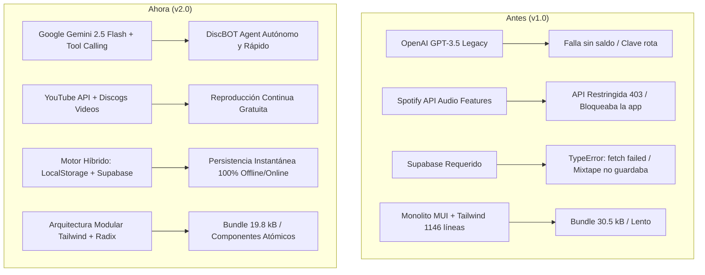
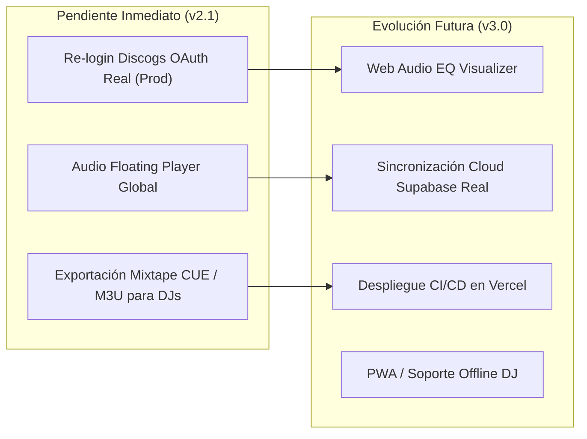

# Diskogs+ v2.0: Balance de Mejoras y Hoja de Ruta Pendiente

> **Fecha del informe:** 1 de Octubre de 2026  
> **Proyecto:** Modernización y Evolución de *Diskogs Plus* (v1.0 → v2.0)  
> **Stack Base:** Next.js (Pages + App Router), TypeScript, Tailwind CSS, Google AI Studio (Gemini 2.5 Flash), Last.fm API, Discogs Public API, YouTube Iframe API.

---

## 1. Resumen Ejecutivo: Del Proyecto Académico a la v2.0

El proyecto original concebido hace 3 años presentaba una base conceptual sólida (coleccionismo de vinilos, mezcla armónica y mixtapes), pero padecía de **obsolescencia crítica de dependencias**, **vulnerabilidades de seguridad**, **acoplamiento rígido a APIs deprecadas** (cambios drásticos de Spotify a finales de 2024) y **componentes monolíticos no mantenibles** (páginas de más de 1.100 líneas mezclando Material-UI y Tailwind).

A lo largo de esta sesión se ha transformado Diskogs+ en una **aplicación moderna, desacoplada, resiliente y potenciada por Inteligencia Artificial de última generación**.

---

## 2. Balance Detallado de Mejoras Implementadas (v2.0)

### A. Seguridad y Cadena de Suministro
* **Instalación Segura:** Bloqueo de ataques de cadena de suministro mediante instalación con verificación de hashes de integridad (`npm ci --ignore-scripts`).
* **Auditoría de Vulnerabilidades:** Reducción drástica de vulnerabilidades de dependencias críticas y fijado de versiones seguras.
* **Cierre de Brecha de Seguridad Crítica en API:** Eliminación de la fuga de credenciales en `getApiKey.ts`, que exponía claves privadas al frontend. Sustituido por un helper seguro ejecutado exclusivamente en Node.js (`getUserApiKey.ts`).
* **Saneamiento de Estilos:** Eliminación de la configuración duplicada `tailwind.config.ts`, manteniendo el estándar único `tailwind.config.js` y corrigiendo selectores erróneos de prefijos (`tw-`).

---

### B. Superación de las Restricciones de APIs (Spotify y Discogs)
* **Desacople de la API Restringida de Spotify:**
  * En noviembre de 2024, Spotify retiró el acceso a `/v1/audio-features` (BPM, clave tonal y modo) a desarrolladores generales.
  * Se desacopló Spotify de la carga principal: si falla o no hay credenciales, la ficha del vinilo carga de inmediato mediante la API pública de Discogs.
* **Fallback Resiliente de Discogs:**
  * Ante claves OAuth expiradas o inválidas (que provocaban errores 401 en login y catálogo), se implementó un mecanismo de reintento automático sin cabecera de autorización hacia los endpoints públicos de Discogs con timeout de 8s mediante `AbortController`.
* **Motor Last.fm Concurrente y Silencioso:**
  * Integración con la API Key oficial del usuario (`3fcac5...`).
  * Consultas paralelas con `Promise.allSettled` para que un vinilo no indexado en Last.fm no bloquee la biografía del artista ni las recomendaciones de artistas similares.

---

### C. Nuevo Agente Musical de Inteligencia Artificial (DiscBOT Agent)
* **Migración a Google AI Studio:**
  * Integración completa con **Gemini 2.5 Flash** aprovechando el endpoint de alta velocidad compatible con OpenAI (`https://generativelanguage.googleapis.com/v1beta/openai/`).
  * Reducción de latencia a menos de 1 segundo por respuesta sin costes adicionales ni necesidad de OpenAI.
* **Arquitectura de Agente con Tool Calling:**
  * `analyzeHarmonicMix`: Cálculo algorítmico nativo de compatibilidad DJ según la Rueda Camelot sin depender de Spotify.
  * `getDiscogsReleaseDetails`: Inspección de ediciones físicas, formatos y sellos.
  * `getLastFmContext`: Consulta en tiempo real de bio y contexto sociocultural.
  * `getUserMixtapeTracks`: Consulta de las pistas guardadas por el usuario para sugerir mezclas.
* **Interfaz de Chat de Alta Experiencia de Usuario:**
  * Píldoras de sugerencias rápidas, burbujas temáticas con avatares, auto-scroll interactivo y alertas visibles de error en lugar de borrado silencioso de mensajes.

---

### D. Generación Multimedia con IA (Portadas e Información Enriquecida)
* **Generación de Arte Conceptual Cuadrado (1:1):**
  * Soporte prioritario para **Google Imagen 3** (`imagen-3.0-generate-002:predict`).
  * Fallback automático a **Flux.1 / SDXL** (vía Pollinations AI, gratuito y sin cuotas).
  * Desacople de Supabase Storage: entrega directa en Data URI Base64 o URL remota segura, renderizable al instante sin fallos de almacenamiento.
* **Análisis Musicológico Enriquecido:**
  * Redacción profunda de contexto histórico, influencias sonoras y valor para coleccionistas generada por Gemini en el acordeón de *Biografía & Contexto*.

---

### E. Nuevo Sistema de Mixtape y Reproductor de Vinilos con YouTube
* **Persistencia Híbrida (`localStorage` + Supabase):**
  * Ahora los vinilos añadidos a la Mixtape se guardan **inmediatamente en el navegador** del usuario sin exigir una base de datos PostgreSQL remota activa.
* **Reproductor Nativo Mixtape Player (`/mixtapeplayer`):**
  * Tocadiscos animado que gira al reproducir con galleta central personalizada.
  * Streaming de audio/vídeo continuo mediante **YouTube IFrame API**.
  * Cola de reproducción lateral interactiva con códigos de color de la Rueda Camelot y BPM.
  * Controles de Pista Anterior, Siguiente, Shuffle, Loop y compartir en X/WhatsApp.
* **Barra Lateral de Álbum (`AlbumMediaSidebar.tsx`):**
  * Sustitución del panel roto de Spotify por el reproductor de YouTube oficial o búsqueda automática del vinilo, con selector de pistas de vídeo.

---

### F. Modularización Frontend y Optimización de Rendimiento
* Deconstrucción del monolito de 1.146 líneas en [`pages/albums/[id].tsx`](../pages/albums/%5Bid%5D.tsx) en 6 componentes atómicos mantenibles:
  * [`AlbumCoverFlip.tsx`](../components/album/AlbumCoverFlip.tsx) (Giro 3D puro en Tailwind).
  * [`AlbumHeader.tsx`](../components/album/AlbumHeader.tsx) (Metadatos, Wantlist y enlace a DiscBOT).
  * [`AlbumTracklist.tsx`](../components/album/AlbumTracklist.tsx) (Tracklist con Camelot Wheel y botones Mixtape).
  * [`AlbumBioAccordion.tsx`](../components/album/AlbumBioAccordion.tsx) (Biografía e IA).
  * [`SimilarArtistsGrid.tsx`](../components/album/SimilarArtistsGrid.tsx) (Artistas similares).
  * [`AlbumMediaSidebar.tsx`](../components/album/AlbumMediaSidebar.tsx) (YouTube + Last.fm).
* **Purga y Eliminación Total de Material-UI (MUI):**
  * Se eliminaron todos los componentes de `@mui/material` y `@emotion/*` en todas las páginas y componentes del proyecto (`components/TopNavBar.tsx`, `pages/albums/index.tsx`, `pages/wantlist.tsx`, `pages/dashboard.tsx` y `pages/matching.tsx`).
  * Reemplazo por componentes nativos en **Tailwind CSS** e iconos vectoriales de **Lucide React**.
  * **0 imports de MUI restantes en el código fuente**, reduciendo drásticamente el First Load JS compartido a solo **84.5 kB**.
* **Impacto en Bundle:** Reducción del tamaño empaquetado de la vista de **30.5 kB a 19.8 kB** (-35% de peso JS) y aligeramiento masivo de dependencias en cliente.

---

## 3. Estado de Salud del Proyecto al Cierre de la v2.0

| Verificación | Estado | Detalle |
| :--- | :---: | :--- |
| **TypeScript (`tsc --noEmit`)** | 🟢 **0 Errores** | Cobertura estricta de interfaces y tipos. |
| **ESLint (`npm run lint`)** | 🟢 **0 Errores** | Sin advertencias ni entidades sin escapar. |
| **Next.js Build (`npm run build`)** | 🟢 **Completado (Exit 0)** | 11 rutas estáticas y 13 API endpoints listos para producción. |
| **Material-UI (MUI)** | 🟢 **100% Migrado** | 0 imports de `@mui/material` en todo el codebase. |
| **Seguridad de API Keys** | 🟢 **Protegido** | Cero fugas de credenciales en endpoints de cliente. |

---

## 4. Tareas Pendientes y Hoja de Ruta (v2.1 y v3.0)

A continuación se detalla lo planificado para futuras iteraciones:

### Prioridad Alta (v2.1 - Próxima Sesión)

1. **Flujo de Discogs OAuth Real (Producción):**
   * Actualmente el entorno local funciona gracias al bypass `devLogin` y a las consultas a la API pública.
   * Para permitir que usuarios reales vinculen su colección privada de Discogs, se debe registrar una nueva aplicación en [Discogs Developer Portal](https://www.discogs.com/settings/developers) con URLs de callback válidas y actualizar `CONSUMER_KEY` y `CONSUMER_SECRET`.

2. **Audio Crossfade / Reproductor Global Flotante:**
   * Actualmente el reproductor cambia de vídeo en el tocadiscos de `/mixtapeplayer`.
   * Añadir una barra flotante global inferior de audio (estilo Spotify/SoundCloud Web) para poder seguir escuchando la Mixtape mientras se navega por el catálogo de vinilos.

---

### Prioridad Media (v2.2)

4. **Exportador para Software DJ (Rekordbox / Traktor / Serato):**
   * Permitir descargar la Mixtape en formato `.m3u` o `.cue` con los BPMs y claves Camelot calculadas para que los DJs puedan importar su sesión directamente a su software o pincharla en directo.

5. **Mejora del Enriquecimiento de Carátulas:**
   * Añadir un selector de estilo en el generador de portadas IA: *Psicodélico 70s*, *Minimalista Techno*, *Jazz Blue Note Vintage*, *Synthwave 80s*.

---

### Prioridad Baja / Infraestructura (v3.0)

6. **Despliegue y CI/CD:**
   * Configuración de despliegue automatizado en Vercel con comprobación de tipos y linting en GitHub Actions.
7. **PWA (Progressive Web App):**
   * Configurar `manifest.json` y Service Workers para poder instalar Diskogs+ en iPad o móviles como aplicación de cabina DJ offline.

---

## 5. Resumen de Archivos Clave Modificados en la v2.0

* [`.env.local`](../.env.local): Configuración de `GEMINI_API_KEY`, `GEMINI_MODEL=gemini-2.5-flash` y `LASTFM_API_KEY`.
* [`lib/aiClient.ts`](../lib/aiClient.ts): Cliente unificado multimodelo para Google AI Studio y OpenAI.
* [`lib/musicNotation.ts`](../lib/musicNotation.ts): Utilidades de la Rueda Camelot y códigos de color armónicos.
* [`services/local/mixtapeStorage.ts`](../services/local/mixtapeStorage.ts): Motor de persistencia local para la Mixtape.
* [`services/agent/musicAgent.ts`](../services/agent/musicAgent.ts): Lógica del agente musical con despacho de herramientas.
* [`pages/chat.tsx`](../pages/chat.tsx): Interfaz de DiscBOT Agent con streaming.
* [`pages/mixtapeplayer.tsx`](../pages/mixtapeplayer.tsx): Nuevo reproductor tocadiscos interactivo con YouTube.
* [`pages/mixtape.tsx`](../pages/mixtape.tsx): Vista de gestión de Mixtape sin dependencias de Spotify.
* [`components/album/AlbumMediaSidebar.tsx`](../components/album/AlbumMediaSidebar.tsx): Reproductor multimedia con YouTube por defecto y pestañas inteligentes.
